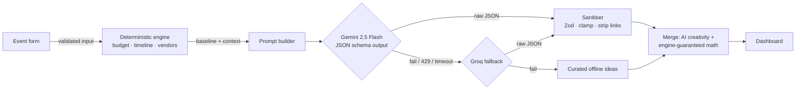

# Utsav — GenAI Celebration & Event Planner

> **PromptWars Virtual · Challenge 5 — Celebration & Event Planner**
> A GenAI-powered planning assistant that helps people organise **weddings, birthdays and community events** with **budgets, timelines, vendor checklists and personalised ideas**.

**Live app:** [https://utsav-ai-event-planner.vercel.app](https://utsav-ai-event-planner.vercel.app) · **Stack:** React 19 · TypeScript · Vite · Vercel Functions · Google Gemini (`@google/genai`) · Groq fallback · Zod

[](https://github.com/prajapatipratik547-ui/utsav-ai-event-planner/actions/workflows/ci.yml)

---

## Why Utsav

Planning an Indian celebration means juggling a budget in lakhs, dozens of vendors, family expectations, dietary rules and a date that does not move. Generic chatbots give pleasant prose with made-up numbers. Utsav gives a **plan you can run**:

| The challenge asks for…                   | Utsav delivers                                                                                                                                                                                                                   |
| ----------------------------------------- | -------------------------------------------------------------------------------------------------------------------------------------------------------------------------------------------------------------------------------- |
| **Budgets**                               | A rupee-exact split across 10 categories, tuned to event type, city tier, style, diet and your top-3 priorities. Edit allocations, log spending, see over-budget alerts, a per-plate health check and an accessible donut chart. |
| **Timelines**                             | 10–19 dated milestones per event type that **compress automatically** when the date is close, plus your own tasks, overdue flags, a month-by-month view and **one-click export to Google/Apple/Outlook calendar (.ics)**.        |
| **Vendor checklists**                     | Venue, caterer, decorator, photographer, mehendi artist, priest, rentals… each with a book-by date tied to the timeline, _what to confirm before you pay_, status tracking and notes.                                            |
| **Personalised ideas**                    | Gemini designs a named theme, a colour palette, decor, a **diet-safe menu**, activities, favours and tips for _your_ city and notes — in English or Hindi.                                                                       |
| **Weddings, birthdays, community events** | 7 event types: wedding, engagement, birthday, anniversary, baby shower, festival (Diwali, Ganesh utsav, Navratri…) and community (society meets, fundraisers, reunions).                                                         |
| _Beyond the brief_                        | Guest list & RSVP tracker with live catering estimate · AI planning assistant that knows your numbers · print/PDF · JSON export · dark mode · works offline.                                                                     |

## How the GenAI is used (and kept honest)



**Design principle: the model is creative, the code is accountable.**

- **Gemini never writes rupee amounts or dates.** It returns _structured JSON_ (`responseJsonSchema`) with a theme, ideas, tips, up to 5 event-specific extra tasks and optional budget _emphasis multipliers_. The engine clamps those multipliers to 0.7–1.4, re-normalises the split, rounds to ₹100 with the largest-remainder method so **every plan sums to the exact budget**, and dates every task. Hallucinated numbers are impossible by construction.
- **Every model response is distrusted.** `shared/engine/enhancement.ts` validates with Zod, drops malformed items instead of failing the whole response, strips links and markup, clips lengths and rejects invalid hex colours.
- **Three-tier resilience.** Gemini → Groq → curated offline library. If the API is unreachable the browser runs the same engine locally. The app never shows an empty state because a model was slow.
- **Assistant with context.** `/api/assistant` sends a compact snapshot of the plan (allocations, spending, next tasks) so answers use the user's real numbers; an offline rule-based assistant answers the common questions when no model is available.
- **Cost-aware.** Thinking is disabled on 2.5 Flash (≈5× faster), identical requests are cached for an hour, and a per-instance daily cap protects free-tier quota.

| GenAI service                                                    | Where it is used                                                                                               |
| ---------------------------------------------------------------- | -------------------------------------------------------------------------------------------------------------- |
| **Google Gemini 2.5 Flash** via the official `@google/genai` SDK | `server/ai/gemini.ts` — plan personalisation with native JSON-schema output; conversational planning assistant |
| **Groq** (OpenAI-compatible, `openai/gpt-oss-20b`)               | `server/ai/groq.ts` — automatic fallback when Gemini is rate-limited or down                                   |

## Quality pillars

### 🔐 Security

- API keys live only in server environment variables; the browser never sees them. `GET /api/health` reports which providers are configured, never the keys.
- All input validated server-side with the **same Zod schema** the form uses (`shared/schema.ts`): enums, ranges, real calendar dates, length limits, control-character and angle-bracket stripping.
- **Prompt-injection defence:** free-text notes are fenced inside `<user_notes>` (and cannot close the fence), the system prompt marks them as untrusted data, and model output is re-validated.
- Strict **Content-Security-Policy** (`script-src 'self'`, no inline scripts — even the theme bootstrap is an external file), HSTS, `X-Frame-Options: DENY`, `nosniff`, Referrer-Policy, COOP, Permissions-Policy (`vercel.json`). `vite preview` serves the same headers so the CSP is tested locally, and the app runs with **zero CSP violations** (Zod runs in `jitless` mode so it never probes `eval`).
- Per-client **rate limiting** with `Retry-After`, 8–24 KB body caps, `application/json` enforcement, cross-site browser requests refused (`Sec-Fetch-Site`), method checks, and generic 500s that never leak internals. Logs are structured and contain no user content.
- No accounts and no server-side storage: guest lists stay in the user's browser. `npm audit` gate in CI.

### ♿ Accessibility (WCAG 2.2 AA)

- **0 axe-core violations** across all 8 screens in both light and dark themes, checked in a real Chrome (including colour contrast), plus axe assertions inside the component tests.
- Skip link, landmarks, one `h1` per view, labelled fields, `fieldset`/`legend` groups, an **error summary that takes focus** and links to each invalid field, `aria-invalid` + `aria-describedby`.
- WAI-ARIA **tabs** with roving tabindex and Arrow/Home/End keys; focus moves to the plan title after generation; a polite live region announces saves, deletions, exports and assistant replies.
- Donut chart has a text alternative _and_ a full data table; progress bars expose values; visible 3 px focus rings; 44 px touch targets; `prefers-reduced-motion`, `forced-colors` and `prefers-color-scheme` respected; Hindi output is tagged `lang="hi"`.

### ⚡ Efficiency

- **Lighthouse (production build): Mobile 100 · 100 · 100 · 100, Desktop 97–99 · 100 · 100 · 100** (Performance · Accessibility · Best Practices · SEO). Mobile FCP/LCP 1.4 s, TBT 0 ms, CLS ≈ 0.
- Nothing blocks first paint: web fonts are attached after render (`display=swap`) and the light/dark theme comes from a CSS media query, not a script.
- Initial JS **≈80 KB gzipped**. The dashboard, the validation library and the offline engine are code-split and loaded on demand (the validator is prefetched when idle).
- No UI framework or chart library: hand-written CSS and an SVG donut.
- Server: warm-instance LRU cache, AbortSignal timeouts on every model call, thinking disabled for latency, and model-call quotas.
- Pure, deterministic engine (no network) → instant offline plans and cacheable AI results. Immutable caching for hashed assets.

### 🧪 Testing

- **198 tests**, ~93 % statement / 85 % branch coverage (thresholds enforced in CI).
- **Engine** — budgets always sum exactly for any amount, weights for every event × style, timeline compression never schedules work in the past, diet-safe menus for every diet, ICS escaping and line folding.
- **API** — Gemini → Groq → offline fallback, caching, daily quota, prompt-injection fencing, 400/403/405/413/415/429/500 paths, provider adapters with mocked SDK and `fetch`.
- **UI** (Testing Library + jsdom + axe) — the full user journey: example → generate → every tab, keyboard tab navigation, error summary focus, budget editing, guests & RSVPs, assistant (online and offline), export, regenerate, delete.
- GitHub Actions runs typecheck, ESLint (TypeScript strict + jsx-a11y strict + React hooks), Prettier, coverage, build and `npm audit` on every push.

### 🧱 Code quality

- One domain vocabulary (`shared/constants.ts`) drives UI, validation, engine and prompts — nothing drifts.
- Framework-agnostic Web-standard handlers (`Request → Response`) with dependency injection; Vercel functions and the Vite dev server are thin adapters over the same code.
- TypeScript `strict` + `noUncheckedIndexedAccess`, pure reducer + selectors for state, zero `any` in source.

## Project structure

```
api/              Vercel functions (thin adapters): plan, assistant, health
server/           Framework-agnostic backend
  ai/             gemini.ts · groq.ts · chain.ts (fallback) · prompts.ts
  handlers.ts     validation, rate limit, cache, quota, error envelope
  guards.ts       TtlCache · RateLimiter · DailyQuota
shared/           Code used by both browser and server
  engine/         budget · timeline · vendors · ideas · enhancement (AI sanitiser) · planner · assistantFallback
  schema.ts       Zod schemas shared by form and API
  ics.ts          RFC 5545 calendar export
src/              React app
  components/     PlannerForm · Dashboard · Tabs · panels/*
  state/          reducer · selectors · storage · context
tests/            shared/ · server/ · ui/
```

## Run it locally

```bash
npm install
cp .env.example .env.local   # add GEMINI_API_KEY (and optionally GROQ_API_KEY)
npm run dev                  # http://127.0.0.1:5173 — the API runs inside the dev server
```

Without any keys the app still works end to end using the offline planner.

| Script                               | Purpose                                                   |
| ------------------------------------ | --------------------------------------------------------- |
| `npm run check`                      | typecheck + lint + tests with coverage + production build |
| `npm test` / `npm run test:coverage` | Vitest suites                                             |
| `npm run build && npm run preview`   | production build served with production security headers  |

### Environment variables

| Name             | Default              | Notes                                |
| ---------------- | -------------------- | ------------------------------------ |
| `GEMINI_API_KEY` | —                    | Google AI Studio key (primary model) |
| `GEMINI_MODEL`   | `gemini-2.5-flash`   | any Gemini model id                  |
| `GROQ_API_KEY`   | —                    | optional fallback provider           |
| `GROQ_MODEL`     | `openai/gpt-oss-20b` |                                      |
| `AI_TIMEOUT_MS`  | `20000`              | per model call                       |
| `DAILY_AI_LIMIT` | `300`                | per-instance model-call cap          |

## Deploy (Vercel)

1. Import the GitHub repository in Vercel (framework preset: Vite — `vercel.json` already sets build, output and headers).
2. Add `GEMINI_API_KEY` (and optionally `GROQ_API_KEY`) under **Settings → Environment Variables**.
3. Deploy. `api/*.ts` become serverless functions automatically.

## Honest limitations

- Plate costs and budget shares are **indicative planning estimates**, not vendor quotes; the UI says so.
- Rate limits and caches are per serverless instance (documented best-effort); swap `server/guards.ts` for Redis/Upstash for strict global limits.
- Plans are stored in the browser only — export JSON to move them between devices.

## License

MIT © 2026 Pratik Prajapati
